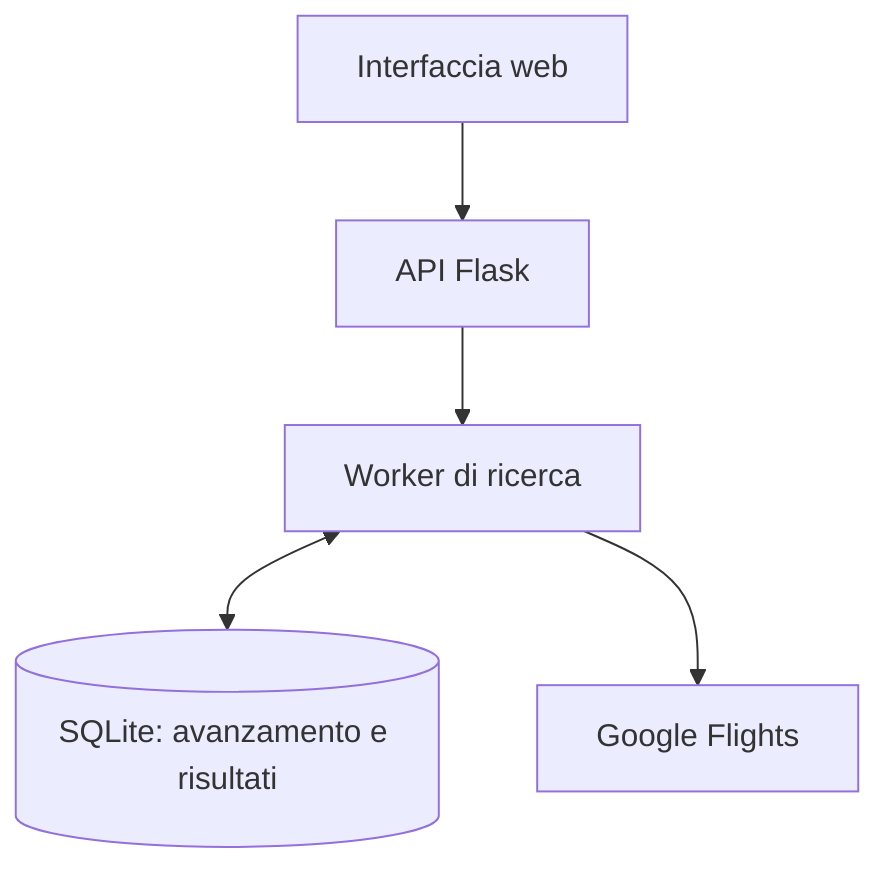

<div align="center">

# ✈️ Flight Finder

**Più aeroporti. Date flessibili. Più tempo per viaggiare.**

Cerca voli, confronta combinazioni e scegli quanto vuoi spendere — e quanto tempo vuoi davvero passare a destinazione.


[Funzionalità](#funzionalità) · [Avvio rapido](#avvio-rapido) · [Architettura](#architettura) · [API](docs/API.md) · [Test](#test) · [Dati e limiti](#dati-copertura-e-limiti)

</div>

---

Flight Finder è un'applicazione web per esplorare viaggi con **date fisse o flessibili**, **sola andata o andata e ritorno**, da **più aeroporti di partenza** verso mete specifiche oppure **Ovunque**.

L'idea nasce da una domanda pratica: *dove posso andare, rispettando il mio budget e gli orari che ho a disposizione?* Il motore combina le tratte, mostra l'avanzamento e conserva i risultati, così puoi confrontare le alternative e ricontrollare il prezzo prima di aprire l'offerta su Google Flights.

> **Scegli tu da dove partire.** Puoi cercare dagli aeroporti italiani e internazionali presenti nel catalogo, selezionandoli per nome, città o codice IATA. **Venezia (VCE) e Treviso (TSF) sono soltanto i valori precompilati per comodità dell'autore: puoi rimuoverli e sostituirli.** Non sono un vincolo del motore.

## Funzionalità

| | Cosa puoi fare |
|---|---|
| 🌍 **Esplorare le destinazioni** | Scegli aeroporti, un paese o la modalità **Ovunque**. Fino a **10 origini** e **200 destinazioni**. |
| 📅 **Sfruttare la flessibilità** | Date esatte oppure un intervallo con giorni e durata del soggiorno configurabili. Il preset **Weekend** prepara una ricerca senza limitare le altre modalità. |
| 🎛️ **Definire il tuo viaggio** | Orari, budget, scali, coincidenze, compagnie, passeggeri, classe e preferenze sui bagagli. |
| 🧭 **Confrontare le alternative** | Risultati per destinazione, tutti i voli, calendario dei prezzi e suggerimenti basati su **prezzo e tempo sul posto**. |
| 💾 **Riprendere una ricerca** | Avanzamento e risultati persistiti in SQLite, con arresto e ripresa anche dopo un riavvio. |
| 🔄 **Ricontrollare i prezzi** | Nuova verifica degli stessi voli e segnalazione delle variazioni, prima di aprire l'offerta. |
| 📄 **Portare con te i risultati** | Esportazione PDF con sintesi per città, dettagli dei viaggi e link a Google Flights. |

**Esempi di utilizzo**

- Confrontare partenze da **Roma Fiumicino e Ciampino** verso più città.
- Cercare un viaggio da **Madrid** verso una destinazione specifica, senza usare aeroporti italiani.
- Impostare un budget e lasciare aperta la meta con **Ovunque**.
- Cercare un fine settimana compatibile con i propri orari, oppure un ritorno in giornata con **zero notti**.

La scelta libera delle origini e la copertura di **Ovunque** sono due cose diverse: la ricerca esplicita accetta gli aeroporti del catalogo, mentre l'esplorazione automatica usa un insieme di destinazioni candidate **non esaustivo**. [Dettagli sulla copertura](#dati-copertura-e-limiti).

<details>
<summary><strong>Tutte le opzioni di ricerca</strong></summary>

- Aeroporti cercabili per nome, città o codice IATA; fino a 10 origini e 200
  destinazioni. Origini precompilate: Venezia e Treviso, modificabili.
- Destinazione anche per paese: scrivendo "Spagna" si aggiungono in un colpo
  tutti i suoi aeroporti collegati alle origini scelte.
- Destinazioni candidate complete oppure gruppi come Europa, mare, city break
  e lungo raggio, recuperati dalla ricerca precedente.
- Date fisse: una partenza e, per l’A/R, un ritorno esatti. Giorni della
  settimana e notti non escludono le date selezionate.
- Date flessibili: periodo, giorni di partenza/ritorno e soggiorno da 0 a
  30 notti. Zero notti permette un ritorno in giornata.
- Il preset **Weekend** compila venerdì dopo le 18, domenica dopo le 18,
  2 notti: è una scorciatoia dello stesso modulo.
- Ritorno nello stesso aeroporto oppure in uno del gruppo di origine;
  ripartenza dallo stesso aeroporto di arrivo oppure da uno del gruppo di
  destinazione esplicito. Gli spostamenti durante il soggiorno non sono inclusi.
- Partenze e arrivi al minuto; arrivo finale entro il giorno di viaggio;
  durata minima/massima delle tratte, inclusi gli scali.
- Diretti o fino a tre scali, durata minima/massima della coincidenza,
  self-transfer, cambio di aeroporto durante uno scalo e scali solo in area
  Schengen come preferenze separate.
- Adulti, bambini con posto, neonati in braccio; classe, filtro bagagli,
  compagnie specifiche, selezione low-cost ed esclusione Basic economy.
- Ordinamento per prezzo totale, tempo a destinazione, durata dei voli o
  partenza. Riepilogo dei prezzi minimi per data sugli stessi risultati live.

La pagina è `/`. I vecchi indirizzi `/classic` e `/weekends` rimandano lì:
non ci sono più pagine o worker separati.

</details>

<details>
<summary><strong>Filtri, calendario e suggerimenti sui risultati</strong></summary>

- **Per destinazione**: una scheda per aeroporto di arrivo con prezzo minimo,
  numero di combinazioni e anteprima del viaggio migliore per l'ordinamento scelto.
  Aprila per vedere tutti i suoi voli oppure passa a **Tutti i voli**.
- **Affina i risultati**: prezzo massimo totale, tempo minimo a destinazione,
  origine, destinazione, compagnia su ogni segmento, rientro entro un orario
  nello stesso giorno e destinazioni da escludere. Un pulsante azzera i filtri.
- **Tre modi di scegliere**: viaggio più economico, più tempo a destinazione
  e miglior compromesso. Quest'ultimo mostra euro aggiuntivi e ore guadagnate:
  ammette al massimo il maggiore tra 20 € e il 50% del prezzo minimo, e
  3 € per ogni ora guadagnata. Tra i candidati sceglie il costo per ora più
  basso. Se nessuno conviene, lo dichiara. In sola andata propone solo il più
  economico; i viaggi con cambio di aeroporto a destinazione non partecipano
  al confronto del tempo.

Filtri, riepiloghi, calendario e suggerimenti lavorano su **tutti** i risultati
salvati, prima della paginazione, e non interrogano Google. Riflettono anche i
ricontrolli del prezzo e le rimozioni dei voli non confermati. I suggerimenti
sono relativi al bacino filtrato e riportano quando il prezzo va aggiornato.
Con una ricerca incompleta sono esplicitamente parziali.

</details>

## Come si usa

1. **Scegli le origini** e le destinazioni, oppure lascia la meta su **Ovunque**.
2. **Imposta le date**, il tipo di viaggio e i vincoli che contano per te.
3. **Controlla il piano**: prima dell'avvio vedi combinazioni e massimo di richieste previste.
4. **Esplora i risultati** mentre arrivano, confrontandoli per prezzo, durata e tempo a destinazione.
5. **Ricontrolla il viaggio scelto**, apri l'offerta su Google Flights oppure esporta i risultati in PDF.

I filtri applicati ai risultati già salvati non avviano una nuova scansione di Google.

## Avvio rapido

Verificato con **Python 3.12**. Le dipendenze sono fissate in [requirements.txt](requirements.txt); includono un pacchetto installato da Git, quindi serve anche **Git**.

```bash
git clone https://github.com/gzanee/Flight-Finder.git
cd Flight-Finder

python3 -m venv .venv
source .venv/bin/activate
python -m pip install -r requirements.txt
python app.py
```

Apri **[http://localhost:5001](http://localhost:5001/)**.

Su Windows, attiva l'ambiente con `.venv\Scripts\activate` al posto di `source .venv/bin/activate`. In sviluppo è disponibile anche `flask --app app run`.

Non è richiesta una chiave API. La ricerca usa librerie non ufficiali per leggere i dati di Google Flights.

### Configurazione

Le variabili d'ambiente sono opzionali. Per la configurazione locale puoi partire da [.env.example](.env.example).

| Variabile | Comportamento |
|---|---|
| `PORT` | Porta del server locale; predefinita `5001`. |
| `FLASK_DEBUG` | Reload di sviluppo con valore `1`; disattivalo con `0`. |
| `LOG_LEVEL` | Livello dei log, per esempio `INFO` o `DEBUG`. |
| `FLIGHT_FINDER_CACHE_DIR` | Directory dei dati locali; il database predefinito è `.cache/weekends.sqlite3`. |
| `FLIGHT_FINDER_GOOGLE_INTERVAL` | Pausa dopo ogni risposta, da `0.3` a `10` secondi; predefinita `0.3`. |

## Architettura

**Python + Flask** espongono l'interfaccia e le API. Un unico motore gestisce le quattro combinazioni di date e tipo di viaggio, mentre **SQLite** conserva lavori, avanzamento e risultati. L'interfaccia è realizzata con **HTML, CSS e JavaScript**.



- `flightcore/flexible.py`: richiesta unica, date, pianificazione e filtri.
- `flightcore/result_browser.py`: filtri sui risultati salvati, gruppi e suggerimenti.
- `flightcore/live_quotes.py`: query fast-flights, decoder fli, cache e retry.
- `flightcore/flexible_jobs.py`: un solo worker, persistenza e ricontrollo.
- `flightcore/flexible_api.py`: pagina e API del motore unico.
- `static/weekends.*`, `templates/weekends.html`: interfaccia unica.
- `app.py`: avvio, autocomplete e traduzione delle vecchie richieste.

I nomi di alcuni file conservano “flexible” o “weekends” per continuità;
tutte le modalità usano questi stessi componenti.

Le API principali sono `/api/search/plan` e `/api/search/jobs`; `/api/flexible/*`
resta un alias sullo stesso manager. Le vecchie `/api/search`, `/api/explore`
e `/api/cheapest-dates` traducono i parametri e restituiscono ora **202 con
l’identificativo del lavoro**, non un elenco sincrono di offerte.
Vedi [docs/API.md](docs/API.md).

Lettura e scrittura dei lavori passano dallo stesso manager. Cache, pause e gestione dei blocchi sono condivise: le modalità non creano worker indipendenti.

### Un esempio di richiesta

Le origini sono parametri della ricerca, come qualsiasi altro filtro. Per esempio, una sola andata da Madrid a Lisbona:

```json
{
  "trip_type": "one_way",
  "date_mode": "fixed",
  "origins": ["MAD"],
  "destinations": ["LIS"],
  "start_date": "2027-03-12",
  "budget": 150
}
```

È un esempio di payload per `POST /api/search/plan` o `POST /api/search/jobs`, non una promessa di disponibilità o prezzo per quella rotta. Usa date future nell'orizzonte supportato dal provider.

Parametri, risposte, ricontrollo, esportazione e compatibilità con le API precedenti sono documentati in **[docs/API.md](docs/API.md)**.

## Test

```bash
python -m pytest -q
python -m ruff check .
node --check static/weekends.js
```

I test usano risposte sintetiche senza interrogare Google. Coprono le quattro
combinazioni tipo viaggio/date, filtri, andata e ritorno verificati,
coincidenze, gruppi di aeroporti, cache, arresto/ripresa, migrazione dei vecchi
lavori e ricontrollo. È un servizio locale a processo singolo, senza coda
condivisa o autenticazione per una pubblicazione multiutente.

## Dati, copertura e limiti

**I risultati sono quotazioni osservate su Google Flights, non conferme dirette delle compagnie.** La ricerca non prenota biglietti e il prezzo può cambiare: ricontrolla l'offerta e le condizioni del venditore prima di acquistare.

Per l'andata e ritorno il prezzo mostrato è la **somma di due biglietti di sola andata**. Quando viene rilevata una tariffa A/R unica più conveniente, è indicata separatamente con un prezzo **“da”**, senza sostituire il totale dei due voli visualizzati.

**Ovunque non significa ogni aeroporto del mondo.** I cataloghi forniscono mete candidate, non confermano rotte o disponibilità. Puoi indicare destinazioni esplicite anche fuori da quel bacino; per origini senza catalogo locale viene usato il bacino generale disponibile.

<details>
<summary><strong>Prezzi, biglietti, bagagli e verifica dei voli</strong></summary>

Per l’A/R confrontiamo due quotazioni di sola andata e ne sommiamo i prezzi,
per tutti i viaggiatori. Si tratta di **due biglietti separati**, non di una
tariffa A/R unica. In sola andata non vengono eseguite ricerche di ritorno.

`verification: google_live` indica dati di shopping osservati su Google:
numero volo, aeroporti, data, orari e prezzo. Non è una conferma della
compagnia: `airline_verified` resta `false`. I prezzi più vecchi di cinque
minuti sono marcati da ricontrollare. Un formato sconosciuto, un blocco o
un errore di connessione non viene interpretato come zero voli.

Filtri su orari, scali, durata e compagnie vengono verificati nuovamente sui
voli restituiti. Classe, bagagli ed esclusione Basic economy sono filtri
inviati a Google; condizioni e inclusioni esatte vanno confermate dal venditore.
Il portale non applica sconti per abbonamenti personali come Wizz Discount
Club o Megavolotea, e non prenota biglietti.

Il cambio di aeroporto durante il soggiorno è distinto da un cambio durante
una coincidenza. Con aeroporti di destinazione diversi mostriamo il tempo
fra i due voli: non stimiamo il tempo né il costo del trasferimento a terra.
Il filtro Schengen usa i paesi della [lista del Consiglio UE](https://www.consilium.europa.eu/en/policies/schengen-area/)
e il paese dell’aeroporto; non è una verifica dei requisiti d’ingresso personali.

</details>

<details>
<summary><strong>Copertura, pianificazione, tempi, cache e gestione dei blocchi</strong></summary>

Wikipedia/Wikidata forniscono destinazioni candidate, non disponibilità o
calendari operativi. Per origini senza catalogo locale usiamo il bacino
complessivo dei cataloghi disponibili. La copertura è **non esaustiva**, anche
per rotte nuove o con scalo. Le destinazioni esplicite permettono di cercare
fuori dal bacino. Non scartiamo una rotta solo perché assente da una tabella.

Prima dell’avvio mostriamo il numero di combinazioni e un massimo di richieste.
Ogni volo viene cercato una volta sola, anche se serve a più durate di
soggiorno, e i ritorni solo dove un’andata rientra nel budget. Una richiesta
a Google porta fino a **10 aeroporti per lato**: per i voli diretti la pagina
elenca tutti i voli di ogni coppia, con gli stessi prezzi delle ricerche
separate (misurato il 12 novembre 2026 fino a 155 voli). Un mese da due
aeroporti verso 132 destinazioni sono al massimo 812 richieste.

Con più aeroporti Google mostra quasi solo voli diretti, quindi i voli con
scalo si cercano una rotta per richiesta. Quando le rotte sono molte (più di
10) la ricerca fa due passate: prima i diretti a gruppi, così i loro viaggi
arrivano in pochi minuti, poi le coincidenze rotta per rotta, che su un
periodo lungo possono richiedere ore e si possono fermare quando si vuole.

A ricerca finita i viaggi vengono confrontati con il prezzo di Google per un
solo biglietto di andata e ritorno: una richiesta per rotta e coppia di date,
al massimo 150, partendo dalle date più economiche di ogni rotta. Se con lo
stesso volo di andata il biglietto unico costa meno, il risultato lo segnala
con un prezzo "da" e "Vedi offerta" apre quella ricerca. Il prezzo del
risultato resta quello dei due voli mostrati: Google non dice quale ritorno
comprende il biglietto unico, e può essere un altro.

Uno scalo è accettato se Google non lo segnala come self-transfer: i biglietti
unici arrivano senza alcun contrassegno, e chi non accetta il self-transfer
chiede anche a Google di nasconderlo. Tutte le modalità
usano lo stesso worker seriale, la stessa cache di cinque minuti e lo stesso
intervallo: **0,3 secondi dopo ogni risposta**, configurabile fra 0,3 e 10 con
`FLIGHT_FINDER_GOOGLE_INTERVAL`. La connessione con Google viene riusata fra
una ricerca e l'altra. Si aggiungono i tempi di risposta e gli
errori di rete: non è una garanzia di durata o di assenza di blocchi.

Google vende i voli fino a 330 giorni da oggi e rifiuta le date successive:
la ricerca le salta e lo segnala a fine lavoro.

Un errore di connessione viene ritentato al massimo due volte. Un 403/429
ferma la ricerca e impone una pausa di quindici minuti nel processo.
Il progresso vive in `.cache/weekends.sqlite3` e può essere ripreso dopo
un riavvio; i lavori salvati dalla precedente versione restano leggibili e,
se ripresi, cercano di nuovo conservando i viaggi già trovati.
`FLIGHT_FINDER_CACHE_DIR` permette di scegliere la directory. Il browser
ripristina l’ultima ricerca, e il calendario riassume i risultati verificati
finora senza una seconda scansione.

</details>

## Il progetto

Flight Finder nasce da un'esigenza personale di pianificazione dei viaggi ed è in sviluppo attivo, anche con il supporto di agenti AI. Questo repository contiene il portale web e il suo motore di ricerca.

È pensato come **servizio locale a processo singolo**. Non include autenticazione o una coda condivisa per l'esposizione come servizio pubblico multiutente.

## Licenza

MIT. Le dipendenze mantengono le loro licenze:
[punitarani/fli](https://github.com/punitarani/fli) e
[AWeirdDev/flights](https://github.com/AWeirdDev/flights).
