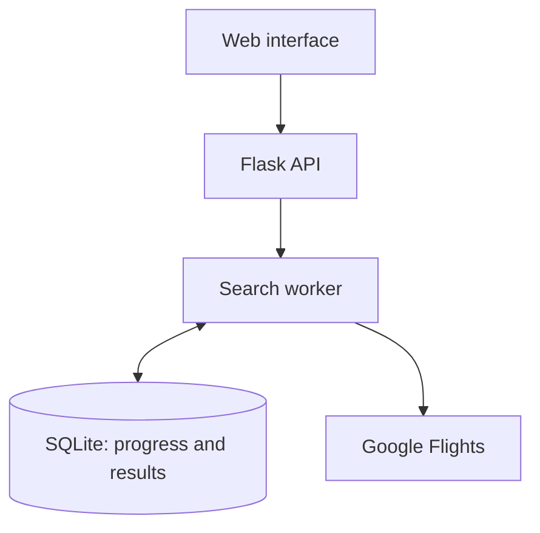

<div align="center">

# ✈️ Flight Finder

**More airports. Flexible dates. More time to travel.**

Search flights, compare combinations and decide how much to spend — and how much time you actually want at your destination.


**English** · [Italiano](README.it.md)

[Features](#features) · [Quick start](#quick-start) · [Architecture](#architecture) · [API reference (Italian)](docs/API.md) · [Tests](#tests) · [Data and limitations](#data-coverage-and-limitations)

</div>

---

Flight Finder is a web app for exploring trips with **fixed or flexible dates**, **one-way or round-trip itineraries**, from **multiple departure airports** to specific destinations or **Anywhere** ("Ovunque" in the current Italian interface).

It starts with a practical question: *where can I go within my budget and the time I have available?* The engine combines flights, shows progress and saves results, so you can compare options and recheck prices before opening an offer on Google Flights.

> **Choose where you fly from.** Search Italian and international airports in the catalog by name, city or IATA code. **Venice (VCE) and Treviso (TSF) are simply the author's convenient defaults: you can remove and replace them.** They do not restrict the search engine.

## Features

| | What you can do |
|---|---|
| 🌍 **Explore destinations** | Select airports, a country or **Anywhere**. Up to **10 origins** and **200 destinations**. |
| 📅 **Make the most of flexible dates** | Choose exact dates or a range with configurable travel days and length of stay. The **Weekend** preset fills in a search without restricting the other modes. |
| 🎛️ **Set your travel preferences** | Times, budget, stops, connections, airlines, passengers, cabin class and baggage preferences. |
| 🧭 **Compare your options** | Browse by destination or view all flights, with a price calendar and suggestions based on **price and time at your destination**. |
| 💾 **Resume a search** | Progress and results are saved in SQLite, with stop and resume support even after a restart. |
| 🔄 **Recheck prices** | Check the same flights again and see price changes before opening the offer. |
| 📄 **Take the results with you** | Export a PDF with city summaries, trip details and Google Flights links. |

**Example searches**

- Compare departures from **Rome Fiumicino and Ciampino** to several cities.
- Search from **Madrid** to a specific destination without using Italian airports.
- Set a budget and keep your destination open with **Anywhere**.
- Find a weekend that fits your schedule, or a same-day return with **zero nights**.

Configurable origins and **Anywhere** coverage are separate things: explicit searches accept airports from the catalog, while automatic exploration uses a **non-exhaustive** set of candidate destinations. [Coverage details](#data-coverage-and-limitations).

<details>
<summary><strong>All search options</strong></summary>

- Search airports by name, city or IATA code; up to 10 origins and 200
  destinations. The prefilled Venice and Treviso origins can be changed.
- Select a destination country: entering "Spagna" (Spain) adds all its
  airports connected to the selected origins at once.
- Reuse the full set of candidate destinations from the previous search,
  or groups such as Europe, seaside, city breaks and long-haul.
- Fixed dates: an exact departure and, for round trips, an exact return.
  Weekday and night-count settings do not exclude the selected dates.
- Flexible dates: a date range, departure/return weekdays and a stay of 0 to
  30 nights. Zero nights allows a same-day return.
- The **Weekend** preset fills in Friday after 18:00, Sunday after 18:00
  and 2 nights: it is a shortcut within the same form.
- Return to the same airport or another in the origin group; depart back
  from the arrival airport or another in the explicit destination group.
  Transfers during the stay are not included.
- Departure and arrival times to the minute; final arrival within the travel
  day; minimum/maximum flight duration, including stops.
- Direct flights or up to three stops, minimum/maximum connection duration,
  self-transfers, airport changes during a connection and Schengen-only
  stops as separate preferences.
- Adults, children with seats and infants on laps; cabin class, baggage
  filters, specific airlines, low-cost selection and Basic economy exclusion.
- Sort by total price, time at destination, flight duration or departure.
  View minimum prices by date using the same live search results.

The page is `/`. The old `/classic` and `/weekends` URLs redirect there:
there are no longer separate pages or workers.

</details>

<details>
<summary><strong>Result filters, calendar and suggestions</strong></summary>

- **By destination**: a card for each arrival airport, with its minimum
  price, number of combinations and a preview of the best trip for the
  selected sort order. Open it to see its flights or switch to **All flights**.
- **Refine results**: maximum total price, minimum time at destination,
  origin, destination, airline on each segment, return by a particular time
  on the same day and destinations to exclude. A button resets the filters.
- **Three ways to choose**: cheapest trip, most time at destination and
  best trade-off. The last option shows the extra euros and hours gained:
  it allows an extra cost up to the greater of €20 or 50% of the minimum
  price, and up to €3 per extra hour. It then picks the lowest cost per
  additional hour among qualifying trips. If none is worthwhile, it says so.
  One-way searches only suggest the cheapest option; trips involving an
  airport change at the destination are excluded from time comparisons.

Filters, summaries, calendar and suggestions use **all** saved results before
pagination and do not query Google. They also reflect price rechecks and the
removal of unconfirmed flights. Suggestions apply to the filtered result set
and indicate when prices need refreshing. They are explicitly marked as
partial when the search is incomplete.

</details>

## How to use it

1. **Choose your origins** and destinations, or select **Anywhere**.
2. **Set the dates**, trip type and constraints that matter to you.
3. **Review the plan**: see the combinations and maximum expected requests before starting.
4. **Explore results** as they arrive, comparing price, duration and time at destination.
5. **Recheck your chosen trip**, open it on Google Flights or export the results as a PDF.

Filtering saved results does not start a new Google search.

## Quick start

Verified with **Python 3.12**. Dependencies are pinned in [requirements.txt](requirements.txt); one package is installed from Git, so **Git** is also required.

```bash
git clone https://github.com/gzanee/Flight-Finder.git
cd Flight-Finder

python3 -m venv .venv
source .venv/bin/activate
python -m pip install -r requirements.txt
python app.py
```

Open **[http://localhost:5001](http://localhost:5001/)**.

On Windows, activate the environment with `.venv\Scripts\activate` instead of `source .venv/bin/activate`. You can also use `flask --app app run` during development.

No API key is required. Searches use unofficial libraries to read Google Flights data. The current app interface is in Italian.

### Configuration

Environment variables are optional. Start from [.env.example](.env.example) for local configuration.

| Variable | Behavior |
|---|---|
| `PORT` | Local server port; defaults to `5001`. |
| `FLASK_DEBUG` | Enable development reload with `1`; disable it with `0`. |
| `LOG_LEVEL` | Log level, such as `INFO` or `DEBUG`. |
| `FLIGHT_FINDER_CACHE_DIR` | Local data directory; the default database is `.cache/weekends.sqlite3`. |
| `FLIGHT_FINDER_GOOGLE_INTERVAL` | Pause after each response, from `0.3` to `10` seconds; defaults to `0.3`. |

## Architecture

**Python + Flask** serve the interface and APIs. A single engine handles the four combinations of date mode and trip type, while **SQLite** stores jobs, progress and results. The interface uses **HTML, CSS and JavaScript**.



- `flightcore/flexible.py`: unified request, dates, planning and filters.
- `flightcore/result_browser.py`: saved-result filters, groups and suggestions.
- `flightcore/live_quotes.py`: fast-flights queries, fli decoder, cache and retries.
- `flightcore/flexible_jobs.py`: single worker, persistence and rechecks.
- `flightcore/flexible_api.py`: page and APIs for the unified engine.
- `static/weekends.*`, `templates/weekends.html`: unified interface.
- `app.py`: startup, autocomplete and translation of legacy requests.

Some filenames retain "flexible" or "weekends" for continuity;
all modes use these same components.

The main APIs are `/api/search/plan` and `/api/search/jobs`; `/api/flexible/*`
remains an alias on the same manager. The legacy `/api/search`, `/api/explore`
and `/api/cheapest-dates` endpoints translate parameters and now return
**202 with a job ID**, rather than a synchronous list of offers.
See [docs/API.md](docs/API.md) (currently in Italian).

Job reads and writes go through the same manager. Cache, delays and block handling are shared: modes do not create independent workers.

### Example request

Origins are search parameters, just like any other filter. For example, a one-way flight from Madrid to Lisbon:

```json
{
  "trip_type": "one_way",
  "date_mode": "fixed",
  "origins": ["MAD"],
  "destinations": ["LIS"],
  "start_date": "2027-03-12",
  "budget": 150
}
```

This is an example payload for `POST /api/search/plan` or `POST /api/search/jobs`, not a promise of availability or price on that route. Use future dates within the provider's supported horizon.

Parameters, responses, rechecks, exports and legacy API compatibility are documented in **[docs/API.md](docs/API.md)** (Italian).

## Tests

```bash
python -m pytest -q
python -m ruff check .
node --check static/weekends.js
```

Tests use synthetic responses without querying Google. They cover the four
trip/date combinations, filters, verified outbound/return combinations,
connections, airport groups, cache, stop/resume, legacy job migration and
price rechecks. This is a local, single-process service, without a shared
queue or authentication for a public multi-user deployment.

## Data, coverage and limitations

**Results are quotes observed on Google Flights, not direct airline confirmations.** The search does not book tickets and prices can change: recheck the offer and the seller's conditions before purchasing.

For round trips, the displayed price is the **sum of two one-way tickets**. When a cheaper single round-trip fare is found, it is shown separately as a **"from"** price without replacing the total for the two displayed flights.

**Anywhere does not mean every airport in the world.** Catalogs provide candidate destinations, not confirmation of routes or availability. You can specify destinations outside that set; origins without a local catalog use the available combined pool.

<details>
<summary><strong>Prices, tickets, baggage and flight verification</strong></summary>

For round trips, the engine compares two one-way quotes and adds their
prices for all passengers. These are **two separate tickets**, not a single
round-trip fare. One-way searches do not make return-flight requests.

`verification: google_live` indicates shopping data observed on Google:
flight number, airports, date, times and price. It is not an airline
confirmation: `airline_verified` remains `false`. Prices older than five
minutes are flagged for rechecking. An unknown format, a block or a
connection error is not interpreted as zero flights.

Time, stop, duration and airline filters are checked again against returned
flights. Cabin class, baggage and Basic economy exclusion are sent to
Google; exact conditions and inclusions must be confirmed with the seller.
The app does not apply personal membership discounts such as Wizz Discount
Club or Megavolotea, and it does not book tickets.

An airport change during the stay is separate from one during a connection.
When destination airports differ, the app shows the time between the two
flights; it does not estimate ground-transfer time or cost. The Schengen
filter uses the countries in the [EU Council list](https://www.consilium.europa.eu/en/policies/schengen-area/)
and the airport's country; it does not check personal entry requirements.

</details>

<details>
<summary><strong>Coverage, planning, timing, cache and block handling</strong></summary>

Wikipedia/Wikidata provide candidate destinations, not availability or
operating schedules. Origins without a local catalog use the combined pool
of available catalogs. Coverage is **non-exhaustive**, including for new
routes and connecting flights. Explicit destinations allow searches outside
that pool. A route is not discarded simply because it is absent from a table.

Before starting, the app shows the number of combinations and a maximum
request count. Each flight is searched only once, even when used for several
lengths of stay, and returns are searched only where an outbound flight fits
the budget. A Google request carries up to **10 airports per side**: for
direct flights, the page lists every flight for each pair at the same prices
as separate searches (measured on November 12, 2026, with up to 155 flights).
A month from two airports to 132 destinations requires at most 812 requests.

With multiple airports, Google mostly shows direct flights, so connecting
flights are searched one route per request. With many routes (more than 10),
the search runs in two passes: grouped direct flights first, so those trips
arrive within a few minutes, then connections route by route. Over a long
period, the latter can take hours and can be stopped at any time.

After a search finishes, trips are compared with Google's price for a
single round-trip ticket: one request per route and date pair, up to 150,
starting with the cheapest dates for each route. If a single ticket with
the same outbound flight costs less, the result shows a "from" price and
the offer link opens that search. The result's own price remains the sum
of the two displayed flights: Google does not identify the return included
in the single-ticket fare, and it may be a different flight.

A connection is accepted if Google does not mark it as a self-transfer:
single-ticket itineraries arrive without that flag, and disabling
self-transfers also asks Google to hide them. All modes use the same serial
worker, five-minute cache and interval: **0.3 seconds after each response**,
configurable between 0.3 and 10 with `FLIGHT_FINDER_GOOGLE_INTERVAL`.
The connection to Google is reused between searches. Response times and
network errors add to this: it is not a guarantee of completion time or
freedom from blocks.

The engine uses a 330-day Google Flights booking horizon and skips later
dates, reporting them at the end of the job.

A connection error is retried at most twice. A 403/429 stops the search
and imposes a fifteen-minute pause within the process. Progress is stored
in `.cache/weekends.sqlite3` and can be resumed after a restart; jobs saved
by the previous version remain readable and, when resumed, search again
while retaining trips already found. `FLIGHT_FINDER_CACHE_DIR` selects the
directory. The browser restores the last search, and the calendar summarizes
results verified so far without a second scan.

</details>

## About the project

Flight Finder grew out of a personal travel-planning need and is in active development, with support from AI coding agents. This repository contains the web app and its search engine.

It is designed as a **local, single-process service**. It does not include authentication or a shared queue for deployment as a public multi-user service.

## License

MIT. Dependencies retain their respective licenses:
[punitarani/fli](https://github.com/punitarani/fli) and
[AWeirdDev/flights](https://github.com/AWeirdDev/flights).
